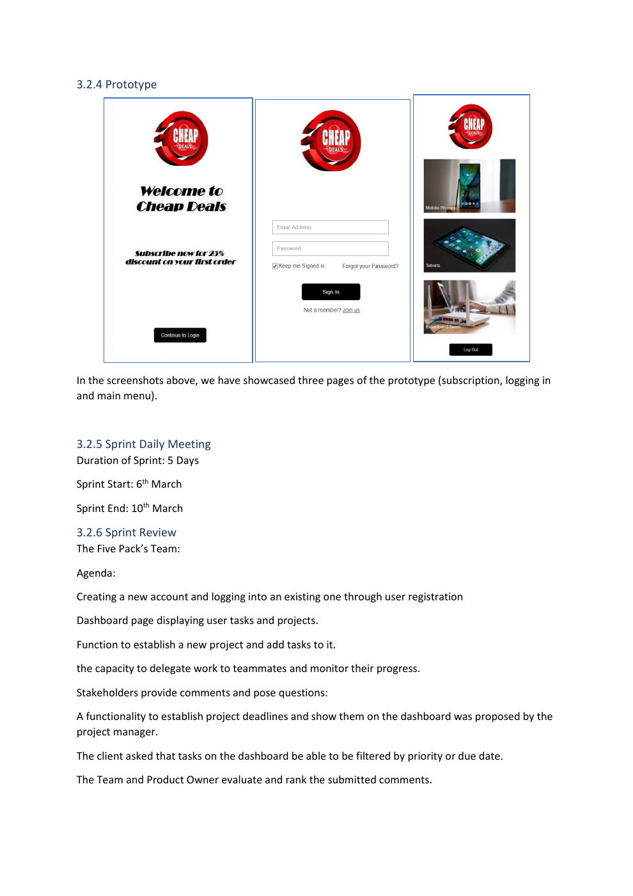

# FastDeal: Scrum Mobile App Project

Group Scrum project for a mobile deals and subscriptions app: product vision, prioritised backlog, sprint planning, prototype screens and retrospectives.

**Project type:** Group agile delivery and prototype report.

## What the work covers

- Develops a mobile product vision for the CheapDeals case study, named FastDeal in the product-vision section.
- Turns requirements into user stories and epics, with MoSCoW prioritisation, an MVP and Planning Poker estimates.
- Documents three sprint cycles through plans, backlogs, use-case diagrams, Scrum boards, burndown charts, prototype screens, reviews and retrospectives.
- Includes individual reflection alongside the collaborative delivery report.

## Explore the repository

- [Completed group report](COMP1807-2022-23%20Agile%20Development%20with%20SCRUM.pdf)
- [Case study and assignment brief](CW_COMP1807_23.pdf)

## Run or read the work

Start with the product vision and backlog, then follow the sprint sections to connect priorities, planned work and prototype evidence. The PDF is the principal deliverable; app source code and a deployable mobile build are not included.

## Scope and limitations

The work demonstrates an academic Scrum process and prototype, not a commercially launched subscriptions service. Team artefacts are collaborative, and the report includes reflections on how work was shared.

## Academic context

University of Greenwich coursework, COMP1807. The linked specification, where present, is assessment context rather than a completed project deliverable. Reports and source are preserved in their original form.

The preview is taken from the original report; it is not a newly executed result.
